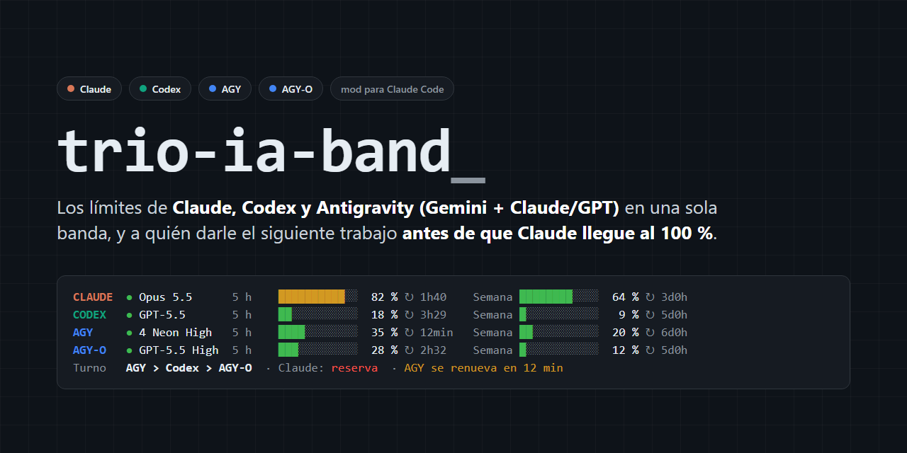
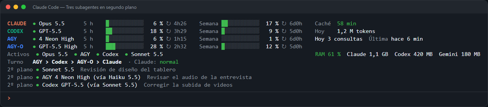
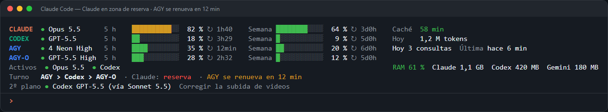
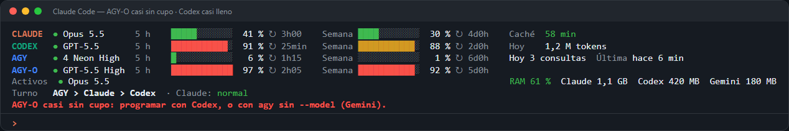
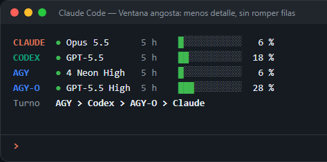

<p align="center"></p>

<p align="center">
  <a href="LICENSE"></a>
  
  
  
  
</p>

# trio-ia-band

> 🌐 [English](README.md) · **Español**

**Claude + Codex + Gemini en una sola banda de Claude Code.** Muestra cuánto cupo le queda a cada uno, qué subagente trabaja en segundo plano y con qué modelo, y a quién conviene darle el siguiente trabajo antes de que Claude llegue al 100 %.

## Contenido

- [Por qué](#por-qué)
- [Cómo se ve](#cómo-se-ve)
- [Qué muestra cada fila](#qué-muestra-cada-fila)
- [Reparto por cupo](#reparto-por-cupo)
- [Instalación](#instalación)
- [Uso](#uso)
- [Privacidad](#privacidad)
- [Desarrollo](#desarrollo)
- [Créditos y licencia](#créditos-y-licencia)

## Por qué

Si usas Claude Code para dirigir y le pasas trabajo a Codex y a Gemini, Claude es el cuello de botella. Cuando su ventana de 5 horas llega al 100 %, nadie coordina, aunque los otros dos estén casi sin usar. Esta banda muestra Claude, Codex y los dos cupos de Antigravity a la vez y le dice a Claude, en cada mensaje, a quién darle trabajo.

## Cómo se ve

**Tres subagentes en segundo plano.** Cada uno con su modelo y su tarea; si solo es un puente hacia Gemini o Codex, lo dice con `(vía …)`.



**Claude en zona de reserva.** Claude pasó del 75 %: sale del reparto y el turno manda el trabajo a Gemini, que además renueva su ventana en 12 minutos.



**Gemini cortado por límite y Codex casi lleno.** Gemini sale del reparto y Codex baja de prioridad porque su semana pasa del 85 %.



**Ventana angosta.** Al estrechar la terminal se quita detalle (semana, reinicios, memoria) sin romper las filas.



## Qué muestra cada fila

| Fila | Contenido |
|---|---|
| **CLAUDE** | Modelo, si está trabajando (●), % usado de 5 h y de la semana con su reinicio, y minutos estimados de caché de prompts. |
| **CODEX** | Modelo, % usado de cada límite con su reinicio y tokens de hoy. Lee los registros locales de `~/.codex/sessions` (o `CODEX_HOME`). ● verde trabajando, ● gris abierto, ○ cerrado. |
| **AGY** | Grupo Gemini de Antigravity. Muestra el último modelo Gemini usado y el consumo del grupo en 5 h y en la semana. Si falta la lectura del cupo, usa una estimación del registro (≈). |
| **AGY-O** | Grupo Claude y GPT de Antigravity. Muestra el último modelo usado en ese grupo (por ejemplo, Opus, Sonnet o GPT) y su consumo en 5 h y en la semana. |
| **Activos** | Modelo principal y subagentes agrupados, más RAM y memoria de Claude, Codex y Gemini. |
| **Turno** | Orden recomendado para dar trabajo ahora y zona de Claude: normal, delegar todo, reserva o crítico. |
| **2º plano** | Una línea por subagente con modelo y tarea. Hasta 4 líneas y luego «+N más». |

Los modelos de cada grupo de Antigravity comparten el mismo cupo. La banda consulta ambos grupos con `agy -p /usage` cada dos minutos (la consulta no gasta cuota). Si hay espacio, muestra en gris la lista de modelos de cada grupo.

Las barras pasan de verde a ámbar y rojo cerca del límite. Avisa una vez por umbral, al 80 % y al 95 %, aunque la banda esté oculta.

## Reparto por cupo

Para cada uno calcula un puntaje:

- **Cupo libre** de la ventana de 5 h. A Claude se le descuenta una **reserva del 25 %** para coordinar y revisar.
- **Cupo por vencer:** si la ventana se renueva en 60 minutos o menos, el cupo libre vale hasta el doble, porque se pierde si no se usa.
- **La semana manda:** con la semana en 85 % o más, el puntaje baja a 0,3. Con 97 % o un corte (429), sale del reparto.

| Zona de Claude (5 h) | Qué hace Claude |
|---|---|
| menos de 50 % | Reparto normal: planea y revisa; Codex y Gemini programan en paralelo. |
| 50–75 % | Delega toda implementación y exploración. |
| 75–90 % | Reserva: solo coordina y deja trabajos largos a Codex y Gemini, que siguen aunque Claude pare. |
| 90 % o más | Crítico: deja lo pendiente encargado y avisa la hora de renovación. |

En cada mensaje tuyo, el mod adjunta para el modelo (tú no lo ves) un bloque «Estado del equipo» con estos números y la prioridad. Para que Claude lo siga, agrega a tu `CLAUDE.md` una regla como esta:

```markdown
# Reparto por cupo
Cada mensaje trae un bloque «Estado del equipo» del mod trio-ia-band. Sigue su «Prioridad para dar trabajo ahora»
y la zona de Claude. Si dos tareas son independientes y van en archivos distintos, lánzalas en paralelo.
```

## Instalación

Requiere Claude Code 2.1.275 o posterior. En la terminal, en el prompt de Claude Code:

```
/plugin install trio-ia-band --marketplace lburgoss/trio-ia-band
```

Responde `y` para agregar el marketplace y elige el alcance de usuario. Desde una consola:

```
claude plugin install trio-ia-band --marketplace lburgoss/trio-ia-band
```

En la app de escritorio: **+** junto al prompt → **Plugins** → **Add marketplace** con `lburgoss/trio-ia-band` → **Add plugin**.

**Opcional, para las filas de Codex, AGY y AGY-O:**

- [Codex CLI](https://github.com/openai/codex) con sesión iniciada. La banda solo lee sus registros locales.
- Antigravity CLI (`agy`) con sesión iniciada. En Windows se busca en `%LOCALAPPDATA%\agy\bin\agy.exe`; en otros sistemas, `agy` en el `PATH`.

Sin ellos, esas filas dicen «sin datos todavía» y el reparto les supone un 50 % de cupo.

## Uso

- **`/estado`** (o `/team-band`) muestra u oculta la banda; la preferencia se recuerda entre sesiones.
- **Idioma:** se detecta solo (español o inglés). Para fijarlo, `/config` → `trio-ia-band.language` → `auto`, `en` o `es`.
- Funciona en la terminal y en la app de escritorio.

## Privacidad

Todo se calcula en tu computadora. La banda lee los límites que Claude Code ya conoce, los archivos locales de Codex y la salida de `agy -p /usage`. No envía nada a ningún servidor ni guarda claves.

## Desarrollo

```
claude --plugin-dir ./trio-ia-band     # cargar el mod desde la carpeta
claude plugin test ./trio-ia-band      # correr las pruebas
claude plugin validate ./trio-ia-band
```

| Archivo | Qué hace |
|---|---|
| `hooks/band.ts` | Dibuja las filas y las adapta al ancho. |
| `hooks/turno.ts` | Reparto por cupo y bloque «Estado del equipo». |
| `hooks/limits.ts` | Pronóstico de los límites y avisos al 80 % y 95 %. |
| `hooks/codex.ts`, `hooks/gemini.ts` | Lectura de Codex y de Antigravity. |
| `hooks/register.tsx` | Eventos de Claude Code: dibujo, turnos, subagentes y `/estado`. |

Las imágenes de `docs/` se generan con los datos de ejemplo y el mismo código de `band.ts`.

## Créditos y licencia

MIT. Adapta componentes de **KOZMOS**, de Ersin Koç (MIT). No está afiliado a Anthropic, OpenAI ni Google; Claude, Codex y Gemini son marcas de sus dueños.
