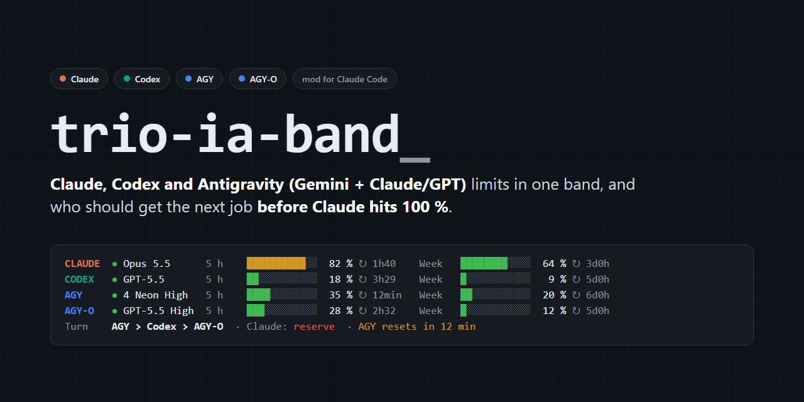
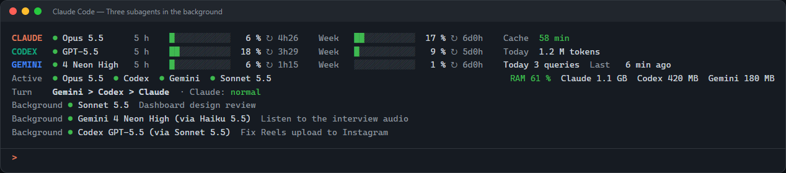
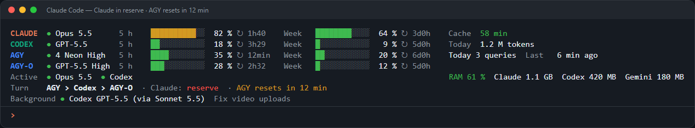
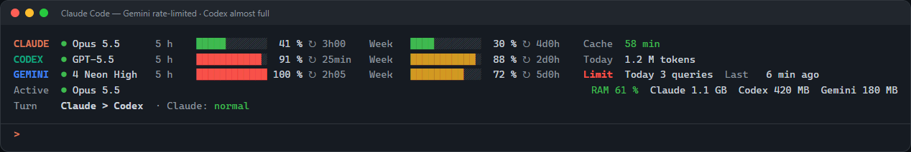
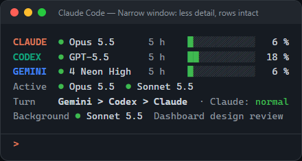

<p align="center"></p>

<p align="center">
  <a href="LICENSE"></a>
  
  
  
  
</p>

# trio-ia-band

> 🌐 **English** · [Español](README.es.md)

**Claude + Codex + Gemini in one Claude Code band.** See how much quota each one has left, which subagent is working in the background and on which model, and who should get the next job before Claude hits 100 %.

## Contents

- [Why](#why)
- [What it looks like](#what-it-looks-like)
- [What each row shows](#what-each-row-shows)
- [Quota-aware work split](#quota-aware-work-split)
- [Install](#install)
- [Usage](#usage)
- [Language](#language)
- [Privacy](#privacy)
- [Development](#development)
- [Credits and license](#credits-and-license)

## Why

If you use Claude Code to orchestrate and hand work to Codex and Gemini, Claude is the bottleneck. When its 5-hour window reaches 100 %, nobody coordinates, even if the other two are barely used. This band shows Claude, Codex and both Antigravity quotas at once and tells Claude, with every message, who should get the work.

## What it looks like

**Three subagents in the background.** Each one with its model and task. When a subagent is only a bridge to Gemini or Codex, it says so with `(via …)`.



**Claude in its reserve zone.** Claude is past 75 %, so it leaves the split and the turn sends work to Gemini, whose window also resets in 12 minutes.



**Gemini rate-limited and Codex almost full.** Gemini leaves the split, and Codex drops in priority because its week is past 85 %.



**Narrow window.** In a narrow terminal the band drops detail (week, resets, memory) without breaking rows.



## What each row shows

| Row | Content |
|---|---|
| **CLAUDE** | Model, whether it is working (●), 5-hour and weekly usage with reset time, and estimated prompt-cache minutes left. |
| **CODEX** | Model, usage of each limit with reset time, and today's tokens. Reads local logs in `~/.codex/sessions` (or `CODEX_HOME`). Green ● working, grey ● open, ○ closed. |
| **AGY** | Antigravity's Gemini group. Shows the last Gemini model used and the group's 5-hour and weekly usage. Falls back to a log estimate (≈) when quota readings are unavailable. |
| **AGY-O** | Antigravity's Claude and GPT group. Shows the last model used in that group (such as Opus, Sonnet or GPT) and its 5-hour and weekly usage. |
| **Active** | Main model and grouped subagents, plus RAM and the memory used by Claude, Codex and Gemini. |
| **Turn** | Recommended order for new work right now, and Claude's zone: normal, delegate all, reserve or critical. |
| **Background** | One line per subagent with model and task. Up to 4 lines, then "+N more". |

Models within each Antigravity group share the same quota. The band reads both groups with `agy -p /usage` every two minutes (the query uses no quota). Wide layouts dim the model list for each group.

Bars go from green to amber to red near the limit. It warns once per threshold, at 80 % and 95 %, even with the band hidden.

## Quota-aware work split

Each member gets a score:

- **Free quota** in the 5-hour window. Claude keeps a **25 % reserve** to coordinate and review.
- **Quota about to reset:** if the window resets within 60 minutes, free quota counts up to double, because it is lost if unused.
- **The week rules:** with weekly usage at 85 % or more the score is multiplied by 0.3. At 97 % or after a rate-limit cut (429), the member leaves the split.

| Claude's zone (5 h) | What Claude does |
|---|---|
| under 50 % | Normal split: Claude plans and reviews; Codex and Gemini code in parallel. |
| 50–75 % | Delegates all implementation and exploration. |
| 75–90 % | Reserve: only coordinates and leaves long, self-contained jobs to Codex and Gemini, which keep running if Claude stops. |
| 90 % or more | Critical: hands off everything pending and tells you when its window resets. |

With every message you send, the mod attaches for the model (you don't see it) a "Team status" block with these numbers and the priority. To make Claude follow it, add a rule like this to your `CLAUDE.md`:

```markdown
# Quota-aware split
Every message carries a "Team status" block from the trio-ia-band mod. Follow its "Priority for new work now"
and Claude's zone. When two tasks are independent and touch different files, run them in parallel.
```

## Install

Requires Claude Code 2.1.275 or later. In a terminal, at the Claude Code prompt:

```
/plugin install trio-ia-band --marketplace lburgoss/trio-ia-band
```

Answer `y` to add the marketplace and pick the user scope. From a shell:

```
claude plugin install trio-ia-band --marketplace lburgoss/trio-ia-band
```

In the desktop app: **+** next to the prompt → **Plugins** → **Add marketplace** with `lburgoss/trio-ia-band` → **Add plugin**.

**Optional, for the Codex, AGY and AGY-O rows:**

- [Codex CLI](https://github.com/openai/codex), signed in. The band only reads its local logs.
- Antigravity CLI (`agy`), signed in. On Windows it is looked up at `%LOCALAPPDATA%\agy\bin\agy.exe`; elsewhere, `agy` on the `PATH`.

Without them, those rows say "no data yet" and the split assumes 50 % quota for them.

## Usage

- **`/team-band`** (or `/estado` in Spanish) shows or hides the band; the choice is remembered across sessions.
- Works in the terminal and in the desktop app.

## Language

The band speaks **English** by default and adapts to the person who installs it. With `language` set to `auto` (the default) it checks, in order, Claude Code's `language` setting, the `LC_ALL`, `LC_MESSAGES` and `LANG` variables, and on Windows the system culture. Spanish is detected today; anything else falls back to English.

To force a language: `/config` → `trio-ia-band.language` → `auto`, `en` or `es`.

New languages are one dictionary in `hooks/i18n.ts`: pull requests are welcome.

## Privacy

Everything is computed on your machine. The band reads the limits Claude Code already knows, Codex's local files and the output of `agy -p /usage`. It sends nothing to any server and stores no keys.

## Development

```
claude --plugin-dir ./trio-ia-band     # load the mod from the folder
claude plugin test ./trio-ia-band      # run the tests
claude plugin validate ./trio-ia-band
```

| File | What it does |
|---|---|
| `hooks/band.ts` | Draws the rows and fits them to the width. |
| `hooks/turno.ts` | Quota-aware split and the "Team status" block. |
| `hooks/i18n.ts` | Texts in each language. |
| `hooks/limits.ts` | Limit forecast and the 80 % / 95 % warnings. |
| `hooks/codex.ts`, `hooks/gemini.ts` | Reading Codex and Antigravity. |
| `hooks/register.tsx` | Claude Code events: drawing, turns, subagents, language and `/team-band`. |

The images in `docs/` are generated from sample data with the same `band.ts` code.

## Credits and license

MIT. Adapts components from **KOZMOS** by Ersin Koç (MIT). Not affiliated with Anthropic, OpenAI or Google; Claude, Codex and Gemini are trademarks of their owners.
